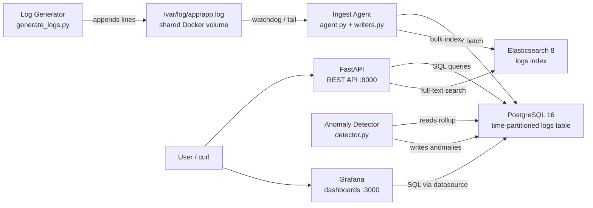
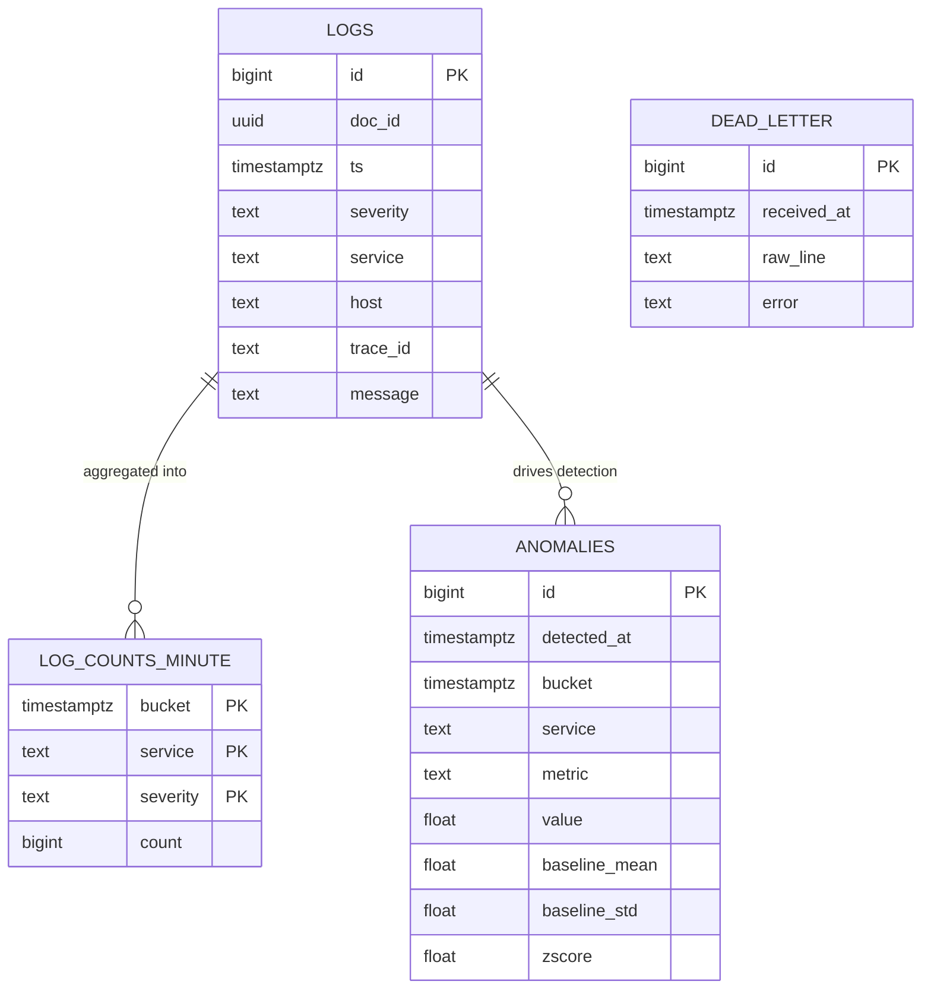

# Architecture

## System Overview

## ER Diagram

## Data Flow

1. **Log Generator** emits structured log lines to a shared Docker volume file.
2. **Ingest Agent** tails the file via watchdog, batches up to 1000 rows or 1 second,
   and flushes to both Postgres (COPY FROM STDIN) and Elasticsearch (bulk API).
3. **Rollup Worker** (embedded in the ingest agent) refreshes `log_counts_minute`
   every 30 seconds by running an idempotent `INSERT ... ON CONFLICT DO UPDATE`.
4. **Anomaly Detector** runs every 60 seconds. It queries the rollup for each service's
   error count in the latest completed minute bucket, computes a z-score against the
   preceding 60-minute baseline, and inserts anomalies when the threshold is breached.
5. **FastAPI** serves parameterized queries against Postgres and delegates full-text
   search to Elasticsearch, hydrating results back from Postgres by `doc_id`.
6. **Grafana** connects directly to Postgres via its built-in datasource and renders
   pre-provisioned panels at startup.

## Design Decisions

### Why two stores?
PostgreSQL provides ACID guarantees, efficient range queries via partition pruning,
and powerful aggregations. Elasticsearch provides sub-millisecond full-text and
fuzzy search. The two stores share a `doc_id` (UUID) so hydration is a point-lookup.

### Why declarative range partitioning?
Daily partitions let Postgres prune irrelevant partitions during time-range scans,
turning a sequential scan into a targeted partition scan. The `create_partitions()`
function provisions ahead to avoid missing-partition errors.

### Why COPY instead of INSERT?
Postgres COPY is typically 10–50× faster than row-by-row INSERT for bulk data,
because it bypasses parse + plan overhead per row.

### Why keyset pagination?
OFFSET-based pagination requires scanning all skipped rows. Keyset pagination on
`(ts DESC, id DESC)` is O(1) per page regardless of position.

### Consistency trade-offs
- ES and Postgres writes are not atomic. A crash between the two leaves ES and PG
  temporarily out of sync. The dead_letter table captures full ingest failures.
- The rollup table may lag up to 30 seconds behind reality.
- Anomaly detection operates on completed minute buckets, so detection latency is
  up to `ANOMALY_INTERVAL + 60` seconds.

### Limitations
- Single-node Elasticsearch with no replicas; not production-HA.
- No authentication on the API; add OAuth2/API keys for production.
- Partition pruning only applies when the query planner sees a constant timestamp;
  parameterized queries with `PREPARE` work correctly.
- The DEFAULT partition will fill up if `create_partitions()` isn't called regularly.
