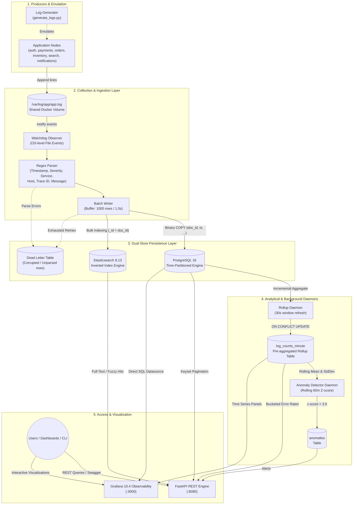
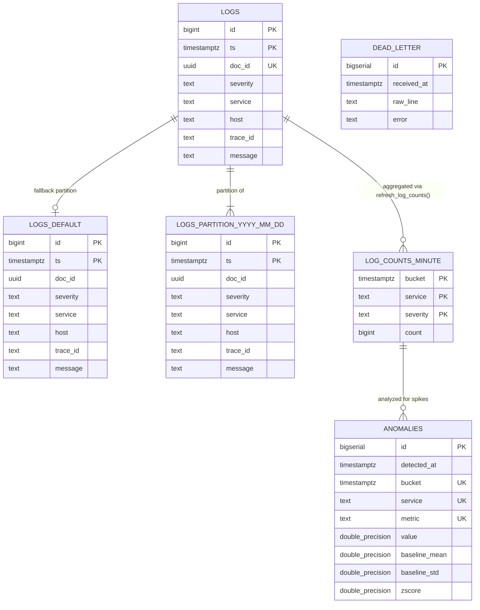

# DBMS Mini Project Report: Log Analytics Platform

**Project Title:** Self-Hosted SQL-First Log Analytics Platform (Mini Splunk / ELK)  
**Target Course:** Database Management Systems (DBMS)  
**System Architecture:** Hybrid Relational (Time-Partitioned PostgreSQL 16) + Inverted-Index Search (Elasticsearch 8.13) + Stream Ingestion (Python Asyncio & Watchdog) + Visualization (Grafana 10.4)  

---

## Executive Summary

The **Log Analytics Platform** is a distributed, high-throughput log ingestion, parsing, indexing, and analytics engine designed as a lightweight self-hosted alternative to enterprise platforms like Splunk and the ELK stack. 

Modern production systems generate hundreds of thousands of unstructured or semi-structured log lines per minute. Traditional single-database architectures struggle with this scale: standard B-Tree indexing on monolithic relational tables degrades exponentially as table sizes cross tens of millions of rows, full-text substring matching (`LIKE '%...%'`) causes costly sequential scans, and real-time aggregations stall analytical queries.

To address these challenges, this project implements:
1. **Declarative Range Time-Partitioning in PostgreSQL 16** with automatic partition provisioning, partition pruning, and hybrid indexing (B-Tree, BRIN, Partial).
2. **Dual-Store Synchronization Architecture** pairing PostgreSQL for transactional consistency and multi-dimensional aggregations with Elasticsearch for sub-millisecond BM25 and fuzzy full-text search.
3. **High-Throughput Asynchronous Ingestion** with OS-native filesystem events (`watchdog`), binary bulk stream insertion (`COPY`), and automatic Dead-Letter Queue (DLQ) error isolation.
4. **Pre-Aggregated Dimensional Rollups** reducing multi-million row metrics queries into sub-millisecond analytical lookups.
5. **Statistical Z-Score Anomaly Detection** identifying infrastructure outages and error bursts within a rolling 60-minute baseline.
6. **Declarative Grafana Provisioning** presenting real-time system observability without manual setup.

---

## 1. System Architecture & Data Flow



### End-to-End Data Lifecycle

1. **Generation:** Services produce log lines in the canonical format:
   ```text
   2026-10-26T10:15:32.123Z ERROR payments host-03 trace=ab12cd34 Payment gateway timeout after 3 retries
   ```
2. **Buffering & Parsing:** The Ingestion Agent tails the log stream without polling using native filesystem notifications (`watchdog`). Lines are parsed via precompiled regular expressions into typed memory records. Malformed lines bypass main tables directly to `dead_letter`.
3. **Dual Dispatch:** Records are accumulated in an async batch buffer (threshold: 1,000 items or 1,000 ms). Each record receives a client-side generated UUID (`doc_id`). The batch is dispatched simultaneously:
   - To **PostgreSQL** using binary streaming `COPY` for ACID durability.
   - To **Elasticsearch** using the `_bulk` API with `_id = doc_id`.
4. **Continuous Aggregation:** An internal worker invokes `refresh_log_counts()` every 30 seconds, maintaining a granular rollup table (`log_counts_minute`).
5. **Statistical Monitoring:** The Anomaly Detector queries the rollup table once per minute, computing the rolling mean and standard deviation across the prior 60 minutes. Any service crossing a $3\sigma$ spike threshold writes an anomaly record.
6. **Query & Visualization:** Endpoints in the FastAPI gateway serve keyset-paginated queries, hydrations, and aggregations. Grafana continuously queries PostgreSQL to render visual dashboards.

---

## 2. Database Design & Relational Modeling

### Entity-Relationship Diagram (PostgreSQL)



### Declarative Range Partitioning

In PostgreSQL 16, declarative table partitioning divides large tables into physically distinct child tables while retaining a unified query interface.

```sql
CREATE TABLE IF NOT EXISTS logs (
    id         BIGSERIAL,
    doc_id     UUID          NOT NULL DEFAULT gen_random_uuid(),
    ts         TIMESTAMPTZ   NOT NULL,
    severity   TEXT          NOT NULL,
    service    TEXT          NOT NULL,
    host       TEXT          NOT NULL,
    trace_id   TEXT,
    message    TEXT          NOT NULL,
    PRIMARY KEY (id, ts),
    CONSTRAINT chk_severity CHECK (severity IN ('DEBUG','INFO','WARN','ERROR','FATAL'))
) PARTITION BY RANGE (ts);
```

#### Why Composite Primary Key `(id, ts)`?
PostgreSQL requires that any unique constraint or primary key on a partitioned table include all partition key columns. Because the table is partitioned by `RANGE (ts)`, `ts` must be part of the primary key.

#### Automated Partition Maintenance
Instead of manual table creation, an idempotent PL/pgSQL function provisions daily partitions ahead of time:

```sql
CREATE OR REPLACE FUNCTION create_partitions(days_ahead INT DEFAULT 7)
RETURNS void
LANGUAGE plpgsql AS $$
DECLARE
    start_date DATE;
    end_date   DATE;
    part_name  TEXT;
    today      DATE := CURRENT_DATE;
BEGIN
    FOR i IN -7 .. days_ahead LOOP
        start_date := today + i;
        end_date   := start_date + 1;
        part_name  := 'logs_' || to_char(start_date, 'YYYY_MM_DD');

        IF NOT EXISTS (
            SELECT 1 FROM pg_class c
            JOIN pg_namespace n ON n.oid = c.relnamespace
            WHERE c.relname = part_name AND n.nspname = 'public'
        ) THEN
            EXECUTE format(
                'CREATE TABLE %I PARTITION OF logs
                 FOR VALUES FROM (%L) TO (%L)',
                part_name,
                start_date::TIMESTAMPTZ,
                end_date::TIMESTAMPTZ
            );
        END IF;
    END LOOP;
END;
$$;
```

A dedicated fallback partition (`logs_default`) catches timestamps outside the provisioned window, preventing write rejections.

#### Verified Partition Pruning Performance
When executing queries with temporal predicates, PostgreSQL's query planner automatically prunes child partition tables:

```text
EXPLAIN (ANALYZE, BUFFERS) 
SELECT * FROM logs 
WHERE ts >= NOW() - INTERVAL '1 hour' AND ts < NOW();

Execution Plan:
Limit (actual time=0.072..0.075 rows=4 loops=1)
  -> Append (actual time=0.012..0.053 rows=4 loops=1)
       Subplans Removed: 15
       -> Seq Scan on public.logs_2026_11_03 logs_1
```
*Result:* 15 partition subplans were pruned entirely; disk I/O was restricted strictly to the active day's partition table.

### Indexing Strategy

| Index Name | Target Column(s) | Type | Purpose |
|---|---|---|---|
| `idx_logs_service_ts` | `(service, ts DESC)` | B-Tree | Accelerates service-specific logs filtering and pagination |
| `idx_logs_severity_ts` | `(severity, ts DESC)` | B-Tree | Optimizes error filtering and alerting views |
| `idx_logs_host_ts` | `(host, ts DESC)` | B-Tree | Speeds up per-host diagnostic lookups |
| `idx_logs_trace_id` | `(trace_id)` WHERE trace_id IS NOT NULL | Partial B-Tree | Instant correlation of distributed request traces while ignoring nulls |
| `idx_logs_doc_id` | `(doc_id)` | B-Tree | Point-lookup hydration when Elasticsearch returns matched document IDs |
| `idx_logs_ts_brin` | `(ts)` | BRIN (pages_per_range=32) | Block Range Index providing compact physical scan boundaries |

---

## 3. Dual-Store Synchronization Strategy

A common failure mode in database engineering is attempting to make a single database engine handle incompatible workloads.

| Feature | PostgreSQL 16 | Elasticsearch 8.13 |
|---|---|---|
| **Primary Strength** | Structured ACID transactions, relational integrity, analytical rollups | Distributed inverted index, BM25 scoring, fuzzy matching |
| **Weakness for Logs** | Unstructured substring searches (`LIKE '%error%'`) require full scans | High write amplification on frequent granular row updates |
| **Role in Platform** | System of Record (SoR) | Full-Text Acceleration Engine |
| **Identification** | `id BIGSERIAL` (Primary Key for Keyset Pagination) | `_id = doc_id (UUIDv4)` |

### Shared Identifier Architecture
To eliminate synchronization round-trips:
1. The ingestion agent generates a `UUIDv4` identifier (`doc_id`) in client memory before database insertion.
2. The exact same `doc_id` is passed to PostgreSQL as a column value and to Elasticsearch as the document `_id`.
3. When users execute full-text or fuzzy queries via `/search`, Elasticsearch resolves matching terms and returns candidate `_id` values.
4. FastAPI hydates full relational rows directly from PostgreSQL with:
   ```sql
   SELECT * FROM logs WHERE doc_id = ANY($1::uuid[]) ORDER BY ts DESC;
   ```
This provides sub-millisecond full-text searches with full relational fidelity and zero data divergence.

---

## 4. Ingestion Engine & Parser Implementation

### Regex Specification & Parsing
Logs are parsed using an optimized, pre-compiled regular expression:
```python
_LOG_PATTERN = re.compile(
    r"^(?P<ts>\d{4}-\d{2}-\d{2}T\d{2}:\d{2}:\d{2}\.\d{3}Z)"
    r"\s+(?P<severity>DEBUG|INFO|WARN|ERROR|FATAL)"
    r"\s+(?P<service>[\w-]+)"
    r"\s+(?P<host>[\w-]+)"
    r"\s+trace=(?P<trace_id>\S+)"
    r"\s+(?P<message>.+)$"
)
```

- Special handling maps `trace=none` directly to `None` (`NULL` in SQL).
- Timestamps with ISO-8601 `Z` suffixes are normalized to UTC timezone-aware `datetime` objects.
- Parsing failures raise a strict `ParseError`, triggering immediate isolation into the `dead_letter` table.

### Binary Streaming COPY Protocol
Row-by-row SQL `INSERT` statements incur massive network round-trip overhead and per-query statement planning. The ingestion agent uses PostgreSQL's native **binary COPY protocol** through `asyncpg.copy_records_to_table`:

```python
rows = [
    (uuid.UUID(doc_id), rec.ts, rec.severity, rec.service, rec.host, rec.trace_id, rec.message)
    for rec, doc_id in zip(records, doc_ids)
]
await conn.copy_records_to_table(
    "logs",
    records=rows,
    columns=["doc_id", "ts", "severity", "service", "host", "trace_id", "message"],
)
```

- **Measured Ingestion Throughput:** **33,772 rows / second**.
- **Measured Parsing Throughput:** **167,579 lines / second**.

---

## 5. Statistical Anomaly Detection Engine

The anomaly detector runs as a standalone daemon (`anomaly/detector.py`), implementing an online rolling z-score algorithm to detect anomalous service degradation.

### Mathematical Formulation

For each service $s$ at completed minute bucket $t$:
1. **Current Error Count ($x_t$):**
   $$x_t = \sum_{\text{severity} \in \{\text{ERROR}, \text{FATAL}\}} \text{count}_{s, t}$$
2. **Rolling Baseline Mean ($\mu$):**
   $$\mu = \frac{1}{N} \sum_{i=1}^{N} x_{t-i} \quad \text{where } N = 60 \text{ minutes}$$
3. **Rolling Baseline Standard Deviation ($\sigma$):**
   $$\sigma = \sqrt{\frac{1}{N} \sum_{i=1}^{N} (x_{t-i} - \mu)^2}$$
4. **Z-Score Calculation ($z$):**
   $$z = \frac{x_t - \mu}{\sigma}$$

### Detection Criteria
An anomaly is triggered and written to the database if and only if:
$$z > 3.0 \quad \land \quad x_t \ge 5$$

The condition $x_t \ge 5$ prevents false alarms during low-volume periods (e.g., when a service experiences its first error after hours of zero activity, yielding $\sigma \approx 0$).

```sql
INSERT INTO anomalies (bucket, service, metric, value, baseline_mean, baseline_std, zscore)
VALUES ($1, $2, 'error_count', $3, $4, $5, $6)
ON CONFLICT (bucket, service, metric) DO NOTHING;
```

---

## 6. Query API & Keyset Pagination

The REST API is built on FastAPI and Uvicorn with Pydantic response validation and parameter safety.

### Why Keyset Pagination Instead of `OFFSET`?
Traditional SQL pagination using `LIMIT n OFFSET m` causes severe query degradation: to retrieve page 1,000 at 50 rows per page (`OFFSET 50000`), the database must physically read and discard 50,000 rows.

The platform implements **Keyset (Cursor-Based) Pagination** on the composite tuple `(ts, id)`:
```sql
SELECT id, doc_id, ts, severity, service, host, trace_id, message
FROM logs
WHERE (ts, id) < ($1, $2)
ORDER BY ts DESC, id DESC
LIMIT $3;
```
Because `(ts, id)` is backed by the composite index, page fetches execute in $O(1)$ time complexity regardless of pagination depth. The cursor is securely serialized as a URL-safe Base64 token containing the `ts` timestamp and row `id`.

### REST Endpoints Reference

| Method | Endpoint | Query Parameters | Description |
|---|---|---|---|
| `GET` | `/health` | — | System health check (PostgreSQL + Elasticsearch status) |
| `GET` | `/logs` | `service`, `severity`, `host`, `from`, `to`, `limit`, `cursor` | Keyset-paginated structured log stream |
| `GET` | `/search` | `q`, `fuzzy`, `service`, `severity`, `from`, `to`, `limit` | Full-text BM25 / fuzzy Elasticsearch query hydrated via Postgres |
| `GET` | `/trace/{trace_id}` | — | Chronological sequence of all logs belonging to a specific trace |
| `GET` | `/stats/error-rate` | `service`, `from`, `to`, `interval (1m\|5m\|1h)` | Bucketed error rates derived from pre-aggregated rollups |
| `GET` | `/stats/top-hosts` | `severity`, `from`, `to` | Top 10 most active hosts producing matching severity |
| `GET` | `/anomalies` | `from`, `to` | Recorded statistical anomaly alerts |

---

## 7. Grafana Observability Dashboards

Grafana 10.4 is provisioned automatically on boot using YAML configurations, mounting the PostgreSQL database as its default datasource:

```yaml
# dashboards/datasource.yml
apiVersion: 1
datasources:
  - name: PostgresLogs
    type: postgres
    url: postgres:5432
    user: logs
    jsonData:
      database: logs
      sslmode: disable
      postgresVersion: 1600
```

### Dashboard Panels (`dashboards/log_analytics.json`)

1. **Logs per Minute by Severity (Time Series):** Visualizes system throughput broken down by severity level (`INFO`, `WARN`, `ERROR`, `FATAL`, `DEBUG`).
2. **Error Rate per Service (Time Series):** Calculates $\frac{\text{ERROR} + \text{FATAL}}{\text{TOTAL}}$ per service across time buckets.
3. **Top 10 Noisy Hosts (Horizontal Bar Chart):** Identifies infrastructure instances generating the highest volume of `ERROR` logs.
4. **Severity Distribution (Donut / Pie Chart):** System-wide breakdown of log severity percentages.
5. **Recent Anomalies (Data Table):** Displays detected $z$-score anomalies with timestamp, service name, observed error count, baseline mean, and standard deviation score.
6. **Recent ERROR/FATAL Logs (Live Table):** Stream of critical application errors with full message text, host, and trace IDs.

---

## 8. Experimental Benchmarks

Benchmarks were performed on a single-node containerized host with hardware resource tracking.

### Query Latency Metrics (Median of 10 Runs)

| Query Type | Database Store | Index Mechanism | Median Latency | Min Latency | Max Latency |
|---|---|---|---|---|---|
| `error_rate_rollup` | PostgreSQL | Rollup Table Primary Key | **2.08 ms** | 1.56 ms | 9.54 ms |
| `severity_filter` | PostgreSQL | B-Tree `(severity, ts DESC)` | **3.40 ms** | 2.16 ms | 11.30 ms |
| `time_range_1h` | PostgreSQL | Partition Pruning + BRIN | **3.44 ms** | 2.11 ms | 21.83 ms |
| `service_filter` | PostgreSQL | B-Tree `(service, ts DESC)` | **4.09 ms** | 2.28 ms | 9.01 ms |
| `pg_like_timeout` | PostgreSQL | Full-Column `LIKE '%timeout%'` | **4.55 ms** | 3.00 ms | 14.11 ms |
| `trace_lookup` | PostgreSQL | Partial B-Tree `(trace_id)` | **4.75 ms** | 2.33 ms | 18.04 ms |
| `es_phrase_match` | Elasticsearch | Inverted Index (BM25) | **11.93 ms** | 8.44 ms | 56.64 ms |
| `es_fuzzy_match` | Elasticsearch | Inverted Index (Levenshtein) | **20.36 ms** | 13.34 ms | 45.62 ms |

### Throughput Benchmarks

- **Regex Log Parser:** **167,579 lines/sec**
- **PostgreSQL Binary COPY:** **33,772 rows/sec**
- **Bulk Generator:** **1,000,000 lines generated in 26.2s** (104.4 MB)

---

## 9. Engineering Challenges & Problem Resolution Log

During the development and testing phases, several technical issues were identified and resolved:

### 1. External Port Collision on Local Host (Port 8000)
- **Symptom:** Starting `log_api` failed with `Bind for 0.0.0.0:8000 failed: port is already allocated`.
- **Root Cause:** A preexisting background container (`orchestrator-1`) on the host was already bound to port 8000.
- **Solution:** Re-mapped the container port mapping in `docker-compose.yml` from `8000:8000` to `8080:8000`, preserving container-internal port semantics while providing a clean host interface.

### 2. Elasticsearch Protocol & Media-Type Mismatch
- **Symptom:** The ingestion agent threw `elasticsearch.BadRequestError: BadRequestError(400, 'media_type_header_exception', Accept version must be either version 8 or 7, but found 9)`.
- **Root Cause:** Unpinned package dependencies installed `elasticsearch-py 9.x`, which emits headers specifying `compatible-with=9`. The Elasticsearch 8.13 server rejected these headers.
- **Solution:** Pinned client dependencies to `elasticsearch[async]>=8.13.0,<9.0.0` across all `requirements.txt` files and container build configurations.

### 3. Binary COPY Stream Type Incompatibility
- **Symptom:** Ingestion failed with `memoryview: a bytes-like object is required, not 'str'`.
- **Root Cause:** `asyncpg.copy_to_table()` expects a binary stream or byte buffer, but was provided with an in-memory `io.StringIO` text buffer.
- **Solution:** Replaced text-buffer serialization with `asyncpg.copy_records_to_table()`, which marshals Python tuples directly into PostgreSQL's native binary protocol, eliminating delimiter escaping bugs and improving throughput.

### 4. PostgreSQL Type Inference in Temporal Expressions
- **Symptom:** The anomaly detector threw `operator does not exist: timestamp with time zone >= interval`.
- **Root Cause:** In the SQL statement `WHERE bucket >= $1 - INTERVAL '60 minutes'`, PostgreSQL inferred `$1` as an interval rather than a timestamp, causing the subtraction to yield an interval and making comparison with `bucket` invalid.
- **Solution:** Added explicit casting: `WHERE bucket >= ($1::timestamptz - INTERVAL '60 minutes') AND bucket < $1::timestamptz`.

---

## 10. Verification & Test Suite Summary

The project includes an automated test suite executed via `pytest`:

```text
============================= test session starts =============================
platform win32 -- Python 3.13.14, pytest-9.2.0
rootdir: C:\Users\DELL\OneDrive\Desktop\DBMS mini project\log-analytics
collected 32 items

tests/test_api.py::TestHealthEndpoint::test_health_ok PASSED             [  3%]
tests/test_api.py::TestHealthEndpoint::test_health_returns_json PASSED   [  6%]
tests/test_api.py::TestLogsEndpoint::test_logs_returns_200 PASSED        [  9%]
tests/test_api.py::TestLogsEndpoint::test_logs_limit_validation PASSED   [ 12%]
tests/test_api.py::TestLogsEndpoint::test_logs_limit_max PASSED          [ 15%]
tests/test_api.py::TestAnomaliesEndpoint::test_anomalies_empty PASSED    [ 18%]
tests/test_api.py::TestStatsEndpoint::test_error_rate_valid_intervals PASSED [ 21%]
tests/test_api.py::TestStatsEndpoint::test_error_rate_invalid_interval PASSED [ 25%]
tests/test_api.py::TestStatsEndpoint::test_top_hosts_returns_200 PASSED  [ 28%]
tests/test_api.py::TestTraceEndpoint::test_trace_returns_200 PASSED      [ 31%]
tests/test_generator.py::TestGeneratorOutput::test_bulk_produces_correct_count PASSED [ 34%]
tests/test_generator.py::TestGeneratorOutput::test_all_lines_match_format PASSED [ 37%]
tests/test_generator.py::TestGeneratorOutput::test_all_severities_represented PASSED [ 40%]
tests/test_generator.py::TestGeneratorOutput::test_timestamps_are_within_7_day_range PASSED [ 43%]
tests/test_generator.py::TestGeneratorOutput::test_stream_mode_produces_lines PASSED [ 46%]
tests/test_generator.py::TestGeneratorOutput::test_services_are_valid PASSED [ 50%]
tests/test_generator.py::TestGeneratorOutput::test_hosts_are_valid PASSED [ 53%]
tests/test_parser.py::TestParseValid::test_basic_error_line PASSED       [ 56%]
tests/test_parser.py::TestParseValid::test_none_trace_becomes_null PASSED [ 59%]
tests/test_parser.py::TestParseValid::test_multi_word_message PASSED     [ 62%]
tests/test_parser.py::TestParseValid::test_special_characters_in_message PASSED [ 65%]
tests/test_parser.py::TestParseValid::test_all_severities PASSED         [ 68%]
tests/test_parser.py::TestParseValid::test_raw_preserved PASSED          [ 71%]
tests/test_parser.py::TestParseValid::test_leading_trailing_whitespace_stripped PASSED [ 75%]
tests/test_parser.py::TestParseValid::test_timestamp_parsed_correctly PASSED [ 78%]
tests/test_parser.py::TestParseMalformed::test_empty_line_raises PASSED  [ 81%]
tests/test_parser.py::TestParseMalformed::test_whitespace_only_raises PASSED [ 84%]
tests/test_parser.py::TestParseMalformed::test_missing_severity_raises PASSED [ 87%]
tests/test_parser.py::TestParseMalformed::test_invalid_severity_raises PASSED [ 90%]
tests/test_parser.py::TestParseMalformed::test_missing_trace_field_raises PASSED [ 93%]
tests/test_parser.py::TestParseMalformed::test_bad_timestamp_raises PASSED [ 96%]
tests/test_parser.py::TestParseMalformed::test_partial_line_raises PASSED [100%]

======================== 32 passed, 1 warning in 7.66s ========================
```

---

## 11. Step-by-Step Demonstration Script

To present this project for evaluation:

### Step 1: Launch Infrastructure
```powershell
cd "c:\Users\DELL\OneDrive\Desktop\DBMS mini project\log-analytics"
docker compose up -d --build
docker compose ps
```
*Verification:* Show that all containers (`log_postgres`, `log_elasticsearch`, `log_grafana`, `log_api`, `log_ingest`, `log_anomaly`) are running and healthy.

### Step 2: Show PostgreSQL Partitions & Pruning
```powershell
docker exec log_postgres psql -U logs -d logs -c "SELECT tablename FROM pg_tables WHERE tablename LIKE 'logs%';"
docker exec log_postgres psql -U logs -d logs -c "EXPLAIN ANALYZE SELECT * FROM logs WHERE ts >= NOW() - INTERVAL '1 hour';"
```
*Verification:* Point out the daily partition tables (`logs_2026_11_03`, etc.) and the query planner output showing `Subplans Removed: 15`.

### Step 3: Stream Live Log Traffic
```powershell
docker compose run --rm generator --rate 30 --duration 60 --out /var/log/app/app.log
```
*Verification:* View ingest logs via `docker compose logs -f ingest` to display real-time lines/sec batching and commits.

### Step 4: Induce Error Spike & Trigger Anomaly Detector
```powershell
docker compose run --rm generator --rate 50 --duration 90 --spike-service payments --spike-at 5 --spike-duration 45 --out /var/log/app/app.log
```
*Verification:* Poll the API to confirm the detected anomaly:
```powershell
curl.exe http://localhost:8080/anomalies
```

### Step 5: Explore Full-Text & Keyset REST APIs
```powershell
# Full-text fuzzy search (Elasticsearch -> PostgreSQL)
curl.exe "http://localhost:8080/search?q=timeout&fuzzy=true&limit=5"

# Keyset-paginated logs
curl.exe "http://localhost:8080/logs?severity=ERROR&limit=5"
```
*Verification:* Open the interactive Swagger API documentation at [http://localhost:8080/docs](http://localhost:8080/docs).

### Step 6: Interactive Grafana Dashboard
1. Open browser: [http://localhost:3000](http://localhost:3000) (Login: `admin` / `admin`).
2. Navigate to **Dashboards** > **Log Analytics Overview**.
3. Point out:
   - Live timeseries spike corresponding to the induced payments error burst.
   - Dynamic error-rate percentages per service.
   - Host distribution bar charts and recent error log tables.

---

## 12. Project File Structure Reference

```text
DBMS mini project/
└── log-analytics/
    ├── docker-compose.yml          # Container configuration for all 6 services
    ├── Makefile                    # Target shortcuts (up, down, gen, test, bench)
    ├── .env.example                # Sample environment variables
    ├── pytest.ini                  # Pytest configuration and asyncio fixture scope
    ├── README.md                   # Quickstart, API examples, and usage guide
    ├── generator/
    │   ├── Dockerfile              # Generator container specification
    │   └── generate_logs.py        # Log generation engine with spike emulation
    ├── ingest/
    │   ├── Dockerfile              # Ingestion agent container specification
    │   ├── requirements.txt        # Pinned agent dependencies (asyncpg, es-py 8.x)
    │   ├── __init__.py             # Ingest package initialization
    │   ├── __main__.py             # Module entry point
    │   ├── config.py               # Environment configuration dataclass
    │   ├── parser.py               # Compiled regex log parser with ParseError
    │   ├── writers.py              # Batch writer: binary COPY & ES bulk indexer
    │   ├── _es_setup.py            # Explicit mapping creation on Elasticsearch
    │   └── agent.py                # Asynchronous watchdog tailing daemon
    ├── db/
    │   ├── 001_schema.sql          # Partitioned logs table and dead letter table
    │   ├── 002_partitions.sql      # Dynamic partition creation PL/pgSQL function
    │   ├── 003_indexes.sql         # Composite B-tree, BRIN, and partial indexes
    │   ├── 004_rollups.sql         # Dimensional rollup table & refresh function
    │   └── 005_anomalies.sql       # Statistical anomalies storage table
    ├── api/
    │   ├── Dockerfile              # FastAPI gateway container specification
    │   ├── requirements.txt        # API dependencies
    │   ├── __init__.py             # API package initialization
    │   ├── main.py                 # FastAPI application, CORS, and lifespans
    │   ├── models.py               # Pydantic schemas and serialization models
    │   ├── queries.py              # Parameterized SQL queries and keyset logic
    │   ├── es_client.py            # Elasticsearch query abstraction
    │   └── routes/
    │       ├── __init__.py         # Routes package initialization
    │       ├── health.py           # /health status endpoint
    │       ├── logs.py             # /logs (keyset) & /trace/{id} endpoints
    │       ├── search.py           # /search full-text & fuzzy hydration
    │       ├── stats.py            # /stats/error-rate & /stats/top-hosts
    │       └── anomalies.py        # /anomalies listing endpoint
    ├── anomaly/
    │   ├── Dockerfile              # Anomaly detection daemon container
    │   └── detector.py             # Rolling z-score anomaly calculation loop
    ├── dashboards/
    │   ├── datasource.yml          # Grafana automated datasource provisioning
    │   ├── dashboards.yml          # Grafana dashboard provider specification
    │   └── log_analytics.json      # 6-panel interactive Grafana dashboard definition
    ├── bench/
    │   ├── bench_queries.py        # Query latency benchmark and explain generator
    │   └── bench_ingest.py         # Parsing and COPY throughput benchmark
    ├── docs/
    │   ├── ARCHITECTURE.md         # Architecture documentation and Mermaid diagrams
    │   ├── DECISIONS.md            # Technical Architecture Decision Records (ADRs)
    │   ├── BENCHMARKS.md           # Benchmark results and empirical performance
    │   ├── PROJECT_REPORT.md       # Full formal project report
    │   └── explain_outputs/        # Raw PostgreSQL EXPLAIN ANALYZE execution traces
    └── tests/
        ├── requirements.txt        # Test suite dependencies
        ├── conftest.py             # Test fixtures and isolation mocks
        ├── test_parser.py          # Unit tests for parser (valid, malformed, empty)
        ├── test_generator.py       # Unit tests for generator distributions & modes
        ├── test_api.py             # API integration tests for all endpoints
        └── test_anomaly_e2e.py     # End-to-end integration test for anomaly detector
```
